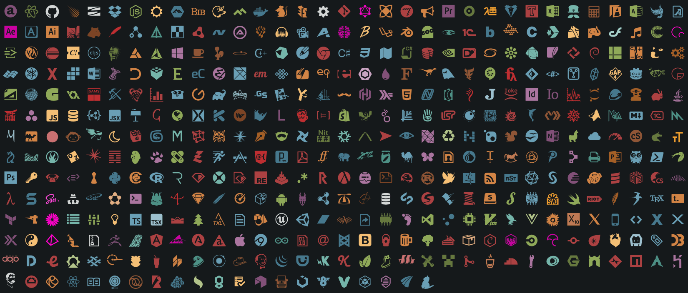

# File Icons

File icons used in **MarkText** and inspired by [file-icons/atom](https://github.com/file-icons/atom/tree/master).



#### Installation

```shell
yarn add @marktext/file-icons
```

#### Usage

```javascript
import fileIcons from '@marktext/file-icons'
import '@marktext/file-icons/build/index.css'

const icon = fileIcons.matchLanguage('javascript')
// iconEle.classList.add(icon.icon)
// icon with color
// iconEle.classList.add(icon.colour[0])
// iconEle.classList.add(icon.colour[1])
```

You can refer more APIs at [atom/icon-tables.js at master · file-icons/atom · GitHub](https://github.com/file-icons/atom/blob/master/lib/icons/icon-tables.js)

CommonJS consumers can use `require('@marktext/file-icons')`. Bundlers can use
the ESM entry at `build/index.mjs` through the package's `module` field. Both
entries use the same stylesheet at `@marktext/file-icons/build/index.css`.

#### Development

Use Node.js 20 or newer and Yarn Classic (1.x).

```shell
yarn install --frozen-lockfile
yarn dev
```

And open browser at `http://127.0.0.1:3000/` to see the example. the example is at folder `src`.

Run `yarn test` to build both module formats and check file/language matching
and the generated stylesheet's font assets.

The upstream `file-icons/atom` dependency uses a commit-specific tarball URL in
`package.json`, with its content checksum recorded in `yarn.lock`. When updating
it, update `yarn.lock` with `yarn install` and run `yarn test` before publishing.

#### Build and Publish

```shell
# Change the version in package.json
# Build to the build folder
yarn build
# Publish to npm
yarn pub
```

#### License

MIT.
